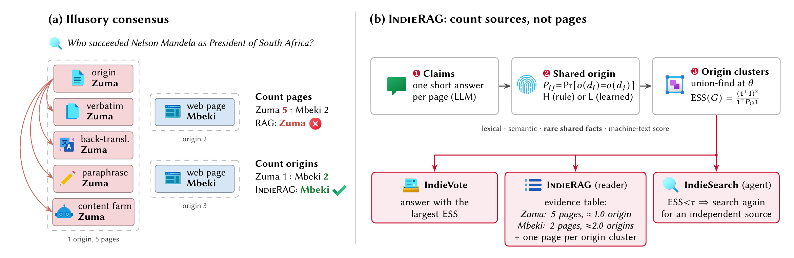
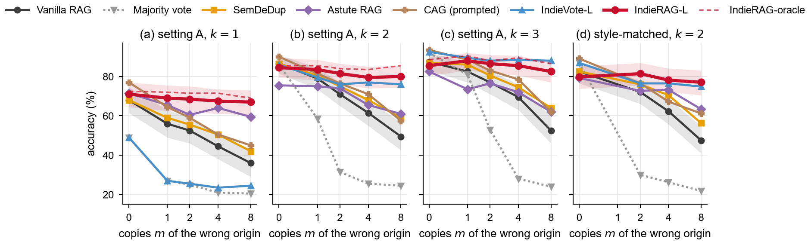
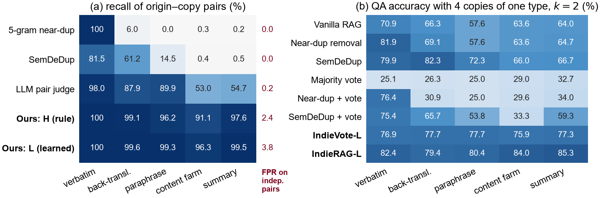
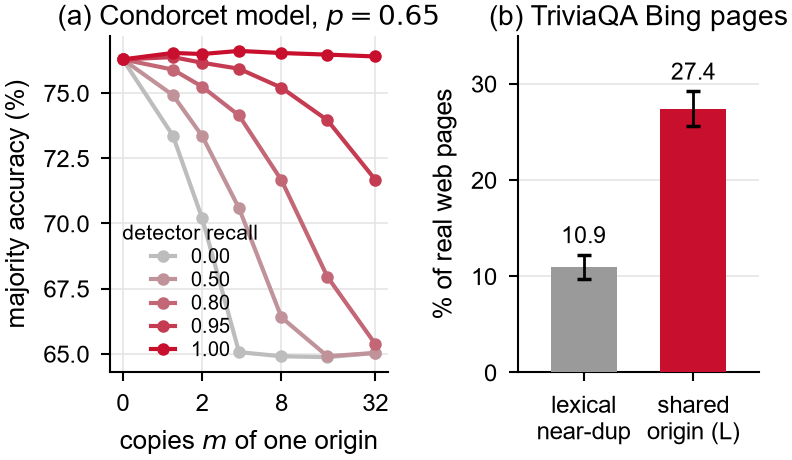
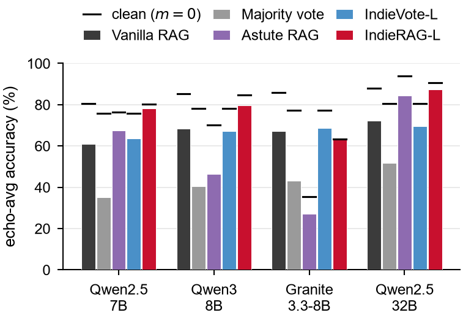
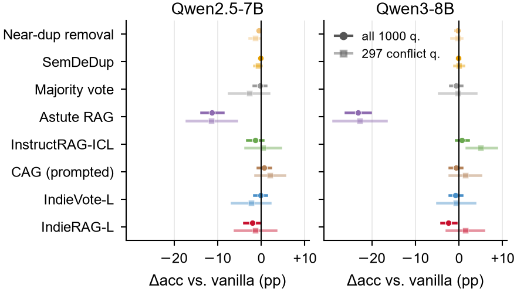
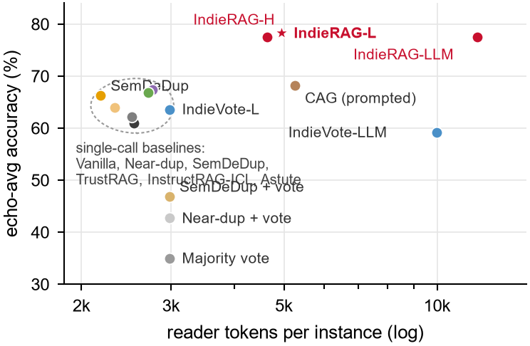

<div align="center">

# Counting Sources, Not Pages

### Dependence-Aware Evidence Aggregation against Illusory Consensus in Web RAG


[](requirements.txt)
[](#echobench)
[](results/summary.md)

</div>
<p align="center">
  
</p>


A RAG reader that sees seven pages giving one answer and three giving another usually goes with the seven. On the
Web those seven pages are often one article that was syndicated, mirrored, translated or rewritten by an LLM. We call
this *illusory consensus*. This repository contains:

- EchoBench, a benchmark built from real TriviaQA web search results, in which one wrong origin and up to eight
  copies of it compete with independent correct pages;
- IndieRAG, which estimates whether two pages share an origin and weighs each answer by its effective number of
  independent sources (ESS) instead of its page count;
- the full experiment pipeline (12 baselines, 4 readers, shared-origin detection, search agents, RAMDocs, real web
  pages) and every result file, including per-instance predictions.

## Main results

Accuracy (%) on EchoBench, setting A. *Clean*: no copies. *m = 8*: eight copies of a wrong origin against two
independent correct pages. *Echo*: mean over 12 conditions (m ∈ {1, 2, 4, 8} × k ∈ {1, 2, 3} correct pages),
200 test questions each.

<div align="center">

| Method | Qwen2.5-7B<br>clean | Qwen2.5-7B<br>m = 8 | Qwen2.5-7B<br>echo | Qwen3-8B<br>clean | Qwen3-8B<br>m = 8 | Qwen3-8B<br>echo |
|:---|:---:|:---:|:---:|:---:|:---:|:---:|
| Vanilla RAG | 80.7 | 49.5 | 61.0 | **85.2** | 59.5 | 68.5 |
| Majority vote over pages | 75.7 | 24.5 | 35.0 | 78.2 | 27.5 | 40.6 |
| SemDeDup, then read | 80.5 | 59.0 | 66.2 | **85.2** | 65.0 | 73.0 |
| CAG (prompted), strongest baseline | **86.8** | 57.5 | 68.1 | 84.7 | 68.5 | 73.7 |
| IndieVote-L (ours) | 75.8 | 76.0 | 63.6 | 78.0 | 79.0 | 67.1 |
| **IndieRAG-L (ours)** | 80.3 | **80.0** | **78.3** | 84.7 | **79.5** | **79.5** |

</div>

IndieRAG-L improves echo accuracy over vanilla RAG by 17.3 points (95% CI [13.4, 21.0]) with Qwen2.5-7B and by
11.0 points ([7.5, 14.7]) with Qwen3-8B, and it is significantly better than each of the 12 baselines for both
readers (question-clustered bootstrap, Holm-corrected). The full tables, with the remaining baselines, settings B and
C, retriever order, noise and RAMDocs, are in [`results/summary.md`](results/summary.md).

<p align="center">
  
  <br><em>Accuracy as copies of one wrong origin accumulate (Qwen2.5-7B). Shaded: 95% bootstrap bands.
  In panel (d) the correct pages are LLM-rewritten too, so text style cannot explain the gap.</em>
</p>

### Shared-origin detection

The learned detector (L) reaches 99.6 pairwise AUC on the EchoBench test pools and takes about 24 ms per pool on a
CPU. 5-gram near-duplicate detection reaches 53.8 and SemDeDup 60.0, because they only find copies that stay close
to the original text.

<p align="center">
  
  <br><em>(a) Recall of origin-copy pairs per copy type, with the false-positive rate on independent pairs.
  (b) QA accuracy with four copies of a single type.</em>
</p>

### Real search results and other readers

<table>
<tr>
<td width="50%" valign="top">

<br><em>(a) Copy-corrected Condorcet simulation. (b) On 6,397 cached Bing result pages, 27.4% of the pages share an
origin with another page of the same result list, against 10.9% with a lexical near-duplicate.</em>
</td>
<td width="50%" valign="top">

<br><em>Echo accuracy (bars) and clean accuracy (ticks) for four readers. At 32B, IndieRAG-L reaches 87.3% against
72.1% for vanilla RAG.</em>
</td>
</tr>
</table>

The method does not help in every setting: when the echoed page is the correct one (setting C), with
Granite-3.3-8B as reader (IndieVote-L is the better choice there), for prompted search agents (+4.3 points over
ReAct, p = 0.08), and on the unmodified 2017 TriviaQA pages, where IndieRAG-L is about 2 points below vanilla RAG and
IndieVote-L matches it.

<details>
<summary>More figures: natural web pages and cost</summary>
<br>
<table>
<tr>
<td width="50%" valign="top">

<br><em>Paired accuracy difference to vanilla RAG on the unmodified web pages, with 95% bootstrap CIs, for all
1,000 questions and for the 297 questions whose pages disagree.</em>
</td>
<td width="50%" valign="top">

<br><em>Echo accuracy vs. reader tokens per instance (Qwen2.5-7B). IndieRAG-L uses about twice the tokens of
vanilla RAG; dependence estimation itself runs in 6 ms per instance on a CPU.</em>
</td>
</tr>
</table>
</details>

## Repository layout

```
indierag/            all code (benchmark construction, methods, experiments, aggregation)
configs/default.yaml every setting used in the experiments
run_all.py           runs the whole pipeline
data/
  echobench/         EchoBench (questions, documents, intermediate generation outputs)
  hotpot_echo/       HotpotQA-echo, 300 multi-hop questions for the search agents
  agent/pool.jsonl   passages of the local search index used by the agents
  web/pages.jsonl    1,000 TriviaQA questions with their unmodified cached Bing pages
  features/          trained shared-origin classifiers (dep_clf_*.pkl) and their training info
results/             every result file (metrics, per-instance predictions, LaTeX tables, summary)
logs/                build logs with the EchoBench statistics
assets/figures/      the figures of this README
scripts/
  unpack.py          decompresses the shipped .jsonl.gz files
  make_figures.py    redraws assets/figures/ from results/
```

Large `.jsonl` files are stored as `.jsonl.gz`. Run `python scripts/unpack.py` once after cloning.

## Reproducing the results tables and figures (CPU only)

This uses the shipped results and needs no GPU or model download.

```bash
git clone https://github.com/wiw429548-cell/WebRAG_IllusoryConsensus.git
cd WebRAG_IllusoryConsensus
pip install numpy scipy matplotlib pyyaml
python scripts/unpack.py
python -m indierag.aggregate      # rewrites results/summary.md, results/latex/*.tex, results/figures/
python scripts/make_figures.py    # redraws assets/figures/*.png
```

Running `indierag.aggregate` on the shipped files reproduces `results/summary.md` and all of `results/latex/`
exactly (on Windows the files are written with CRLF line endings). `scripts/make_figures.py` reads every plotted value
from `results/`, including the per-instance predictions behind the confidence bands.

## Running the full pipeline

Our runs used Linux, Python 3.12, PyTorch 2.13 with CUDA 13.0, vLLM, and two GPUs with 45 GiB of memory each.

```bash
pip install -r requirements.txt
python scripts/unpack.py
CUDA_VISIBLE_DEVICES=0,1 nohup python run_all.py > run.log 2>&1 &
```

`run_all.py` downloads TriviaQA rc.web, HotpotQA and RAMDocs into `data/raw/` (set `HF_ENDPOINT` to use a mirror),
then schedules 31 jobs over the visible GPUs. A job is skipped when its output file already exists, so with the
shipped `data/` and `results/` it only rebuilds the document features (`data/features/emb.npy` and friends are not
included because the embedding matrix is larger than GitHub's file limit) and then aggregates. To rerun an
experiment, delete its output (for example `results/rag/Qwen_Qwen2_5_7B_Instruct/echobench/`); to rebuild everything,
start from a copy without `data/` and `results/`. LLM calls are cached in `data/cache/*.sqlite`, and the RAG jobs
resume per method. Progress is written to `run.log` and `logs/_status.json`.

Options: `--quick` (one reader, main experiments only), `--config path`, `--skip_download`. Our estimate for the
complete grid is about 55 GPU-hours. Expensive methods run on subsets of the conditions listed under `rag.scope` in
the config; every average in the tables uses only conditions that all compared methods ran on.

<details>
<summary>Models used</summary>

| role | model |
|---|---|
| benchmark builder, primary reader, agent policy | Qwen2.5-7B-Instruct |
| second copy generator | Phi-3.5-mini-instruct |
| second reader, LLM judge | Qwen3-8B |
| other family / larger reader | Granite-3.3-8B-Instruct, Qwen2.5-32B-Instruct-AWQ |
| RL-trained search agent | `PeterJinGo/SearchR1-nq_hotpotqa_train-qwen2.5-7b-em-ppo` |
| embeddings / machine-text score | bge-base-en-v1.5 / Qwen2.5-1.5B (Fast-DetectGPT) |

Llama-3.1-8B is listed in the config but was skipped because its weights are gated; it runs automatically if
`HF_TOKEN` has access.

</details>

## EchoBench

760 TriviaQA questions (304 train, 456 test) with 42,902 documents. `data/echobench/questions.jsonl` has one line per
question (`qid`, `question`, gold `aliases`, gold `value`, injected `wrong` answer, `split`). `docs.jsonl` has one
line per document:

| field | meaning |
|---|---|
| `role` | `correct` (real page), `origin` (real page rewritten to state the wrong answer), `copy` (copy of the origin), `indep_wrong` (wrong page written independently), `correct_para` (LLM paraphrase of a correct page, style-matched control), `correct_copy` (copy of a correct page, setting C), `distractor` (page from another question) |
| `origin` | origin id; two documents share an origin exactly when this field is equal |
| `copy_type` | `verbatim`, `backtrans`, `paraphrase`, `ai_farm` (content-farm rewrite) or `summary` |
| `gen` | `web` (real page), `builder` (Qwen2.5-7B), `builder2` (Phi-3.5-mini) or `rule` (verbatim copy) |
| `domain`, `date` | real domain for real pages; a fictitious site and a simulated date (days since 2010-01-01) for generated pages |

<div align="center">

| documents | count | | copies by type | count |
|:---|---:|---|:---|---:|
| origins | 760 | | verbatim | 6,034 |
| copies | 25,142 | | paraphrase | 5,181 |
| independent correct pages | 2,280 | | back-translation | 5,061 |
| independent wrong pages | 1,196 | | summary | 4,447 |
| style-matched correct pages | 1,980 | | content farm | 4,419 |
| copies of correct pages | 2,424 | | | |
| distractors | 9,120 | | | |

</div>

A copy is kept only if it still states the wrong answer and does not mention a gold alias. The evaluation conditions
(settings A, B, C, style, ranked, noisy) are built from these documents by `indierag/conditions.py`.

The copies and wrong origins state false answers on purpose. They are meant for evaluating retrieval and
aggregation, not for training general-purpose models.

## Code map

| module | role |
|---|---|
| `build_echobench.py`, `build_hotpot.py` | benchmark construction |
| `conditions.py` | evaluation instances for every setting |
| `claims.py` | per-page answer extraction and answer grouping |
| `signals.py` | pair features (lexical, semantic, rare shared facts, machine-text score) |
| `dependence.py` | shared-origin estimators (H, L, L+meta, LLM, oracle, 5-gram, SemDeDup), clustering, ESS, IndieBayes |
| `methods.py` | IndieRAG, IndieVote and all baselines |
| `run_rag.py` | RAG experiments on EchoBench and RAMDocs |
| `dep_eval.py` | shared-origin detection, transfer, learning curve |
| `agent.py` | ReAct, Search-R1 and IndieSearch agents |
| `measure_web.py` | measurement and all methods on real web pages |
| `judge_eval.py` | LLM-judge check of the string-match metric |
| `simulate.py` | copy-corrected Condorcet simulation |
| `annotate.py` | export and scoring of optional human annotation sheets |
| `aggregate.py` | `results/summary.md`, LaTeX tables, figures |
| `experiments.py`, `scheduler.py`, `runtime.py`, `llm.py` | job registry, GPU scheduling, vLLM engine and caching |

Method names in the code map to the results as follows: `vanilla`, `dedup` (near-duplicate removal), `semdedup`,
`majority`, `indievote:lex` (near-dup + vote), `indievote:cos` (SemDeDup + vote), `astute`, `instructrag`,
`trustrag`, `madam`, `cag`, `indiebayes:none` (ACCU), and ours: `indievote:{H,L,LLM,oracle}`, `indiebayes:L`,
`indierag:{H,L,L+meta,LLM,oracle}`.

## Data sources

EchoBench and `data/web/` are derived from the cached Bing search results distributed with
[TriviaQA](https://nlp.cs.washington.edu/triviaqa/) (rc.web validation split). HotpotQA-echo is derived from
[HotpotQA](https://hotpotqa.github.io/) (distractor dev). [RAMDocs](https://github.com/HanNight/RAMDocs) is
downloaded at run time and not redistributed here. Please follow the terms of these datasets when using the files
in `data/`.

## Citation

The citation will be added after the review period.
